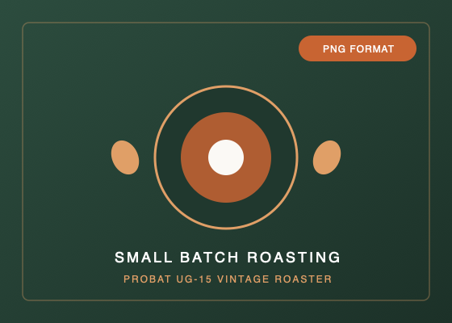

# 05_モダン・レスポンシブWebデザイン

## レスポンシブWebデザイン(RWD)の3大要素
2010年にイーサン・マルコッテ（Ethan Marcotte）氏によって提唱されたレスポンシブWebデザインは、以下の 3つの技術的基盤 によって成り立っている。

1. Fluid Grid (フルードグリッド/流動的格子)

webp/AVIFの方が容量が軽い
ただ、対応してないブラウザもあるためpng/jpegの画像も用意しておく
<picture class="concept__pic">
    <source type="image/webp" srcset="./images/pic_roast.webp">
    // もしwebp/AVIFに対応しているならそれを表示する
    
 </picture>

 // index.html の .menu__list（季節のおすすめメニュー）
.menu__list {
  display: grid;
  // 魔法の1行：各アイテムの最小幅を「260px」、余ったスペースは均等配分（1fr）
  grid-template-columns: repeat(auto-fit, minmax(260px, 1fr));
  gap: rem(32);
}
**【コードの解説】**

- **`repeat()`**：繰り返しの定義。
- **`auto-fit`**：親の幅に入る分だけ自動で列を生成し、余った隙間があれば要素を拡大して埋める。
- **`minmax(260px, 1fr)`**：1列の幅は「最小でも280px、最大なら空きスペースを均等配分（1fr）」。

メディアクエリで `@media (width >= 768px)` などをいちいち指定する必要がなく、画面幅が何ピクセルであっても常に最適な列数で美しくフィットする。
